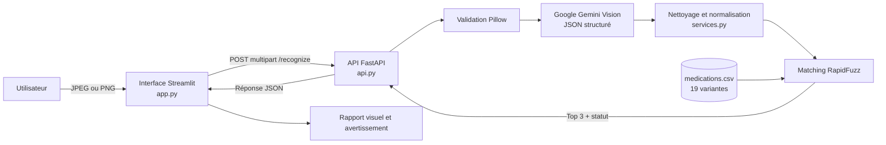

# Documentation technique — Medication Box Recognition

## 1. Présentation générale

**Nom du projet :** Medication Box Recognition, présenté dans l'interface sous le nom « MedBox Vision ».

Le projet aide à identifier une boîte de médicament depuis une photographie. La tâche est difficile à cause des reflets, petits textes, zones cachées, deux langues et variantes d'une même marque. Les emballages visés peuvent combiner français et arabe, tandis que des produits proches diffèrent seulement par leur dosage.

Le MVP extrait uniquement les informations visibles, les compare à un catalogue local et propose au maximum trois candidats. Il ne pose pas de diagnostic et ne recommande ni traitement, posologie ou substitution. Ses scores classent des similarités; ce ne sont pas des probabilités médicales.

Le périmètre couvre une image JPEG/PNG, un modèle de vision préentraîné, 19 variantes CSV et un matching local. Il n'inclut ni entraînement, OCR séparé, détection d'objet, base vectorielle, authentification ou historique.

## 2. Fonctionnalités réalisées

- Téléversement JPEG/PNG avec aperçu, format, dimensions et taille.
- Validation dans l'interface et l'API : type MIME, taille, décodage, format réel et dimensions; limite par défaut de 10 Mo et 25 mégapixels.
- Envoi de l'image à Google Gemini via le SDK officiel `google-genai`.
- Extraction structurée du nom commercial, du principe actif, du dosage, de la forme, de la quantité, du texte visible et des champs manquants.
- Prise en compte de l'arabe et du français.
- Normalisation locale du texte, des chiffres arabes et des unités de dosage.
- Classement de 19 références CSV avec RapidFuzz et conservation des trois meilleurs candidats.
- Affichage des scores de marque, principe actif, dosage et score global.
- Trois statuts : `candidate_found`, `needs_confirmation` et `no_match`.
- Gestion structurée des images invalides, de l'absence de clé, des limites de requêtes, des réponses IA invalides et d'un catalogue indisponible.
- Interface responsive avec état de l'API, onglets de résultat et avertissement médical.

## 3. Architecture du système



`app.py` prévisualise l'image et communique avec FastAPI par HTTP. `api.py` expose le contrat REST, répète les validations et déporte le traitement bloquant dans un thread. `services.py` réunit schémas Pydantic, Gemini, normalisation et classement. `medications.csv` est la source locale modifiable.

Cette séparation garde la clé côté serveur et rend l'API testable indépendamment, sans base de données ni infrastructure complexe.

## 4. Technologies utilisées

| Technologie ou bibliothèque | Rôle réel | Justification dans le MVP |
|---|---|---|
| Python | Langage des trois modules | Écosystème adapté aux API, données et prototypes IA |
| Streamlit | Interface web | Téléversement, aperçu et rapport interactif avec peu de code |
| FastAPI et Uvicorn | API REST et serveur ASGI | Validation, documentation `/docs` et réponses JSON |
| `google-genai` | Client officiel Gemini | Envoi multimodal et sortie JSON contrainte par schéma |
| Pillow | Décodage et contrôle des images | Vérification réelle de JPEG/PNG et aperçu |
| Pandas | Chargement du catalogue | Lecture simple du CSV UTF-8 |
| RapidFuzz | Similarité textuelle | Comparaison rapide de variantes et fautes légères |
| Pydantic | Schémas de données | Validation de l'extraction et de la réponse API |
| Requests | Appels HTTP du frontend | Communication Streamlit vers FastAPI |
| python-dotenv | Configuration locale | Chargement des variables sans clé codée en dur |
| python-multipart | Fichiers multipart | Réception de l'image par FastAPI |
| `unittest` | Tests locaux | Tests du matching sans appel payant |

## 5. Pipeline de reconnaissance

1. **Téléversement :** Streamlit accepte JPG, JPEG et PNG.
2. **Validation :** interface et API refusent les fichiers vides, incohérents, non décodables, trop petits, trop lourds ou supérieurs à 25 mégapixels.
3. **Envoi IA :** l'API crée un `types.Part` puis appelle `client.models.generate_content`.
4. **Compréhension :** Gemini lit directement image et prompt, sans OpenCV ni OCR local.
5. **Extraction :** la réponse respecte `MedicationExtraction`.
6. **Nettoyage :** valeurs vides ou `unknown` deviennent `null`; `missing_fields` est recalculé.
7. **Normalisation :** accents, caractères arabes, chiffres et unités sont harmonisés.
8. **Comparaison :** chaque ligne reçoit trois scores distincts.
9. **Décision :** tri, top 3 et statut final.

Gemini lit l'image. Python valide la sortie, normalise, effectue le matching et applique les conflits.

## 6. Intelligence artificielle et OCR

Le fournisseur est Google. `GEMINI_MODEL` sélectionne le modèle; la valeur actuelle et par défaut est `gemini-3.1-flash-lite`. `GEMINI_API_KEY` fournit la clé sans l'inscrire dans les sources.

Image et consigne sont envoyées ensemble. La sortie demandée est un JSON conforme au schéma Pydantic, avec température 0 et limite de 2 048 jetons :

| Attribut | Contenu attendu |
|---|---|
| `brand_name` | Nom commercial visible |
| `active_ingredient` | Nom générique ou principe actif visible |
| `strength` | Dosage avec nombres et unités |
| `dosage_form` | Forme pharmaceutique visible |
| `package_quantity` | Quantité visible dans l'emballage |
| `visible_text` | Transcription compacte du texte lisible |
| `missing_fields` | Champs absents, cachés ou illisibles |

Le prompt interdit de deviner. Une information incertaine doit être `null`. Pydantic rejette une réponse non conforme et aucun résultat de secours n'est fabriqué après un échec.

Gemini est un modèle vision-langage préentraîné et multilingue. Il permet ce MVP sans dataset d'entraînement. Aucun moteur OCR traditionnel distinct n'est implémenté.

## 7. Matching et reconnaissance

### Catalogue

Le CSV contient 19 variantes et huit colonnes : identifiant, marques latine/arabe, principes actifs latin/arabe, dosage, forme et quantité. Chaque force possède sa ligne, par exemple Doliprane 500 mg et 1 000 mg.

### Normalisation et scores

`normalize_text` passe en minuscules, convertit les chiffres arabes/persans, harmonise certaines lettres arabes, retire les diacritiques et compacte les séparateurs. « Paracétamol » devient `paracetamol`. Les termes de dosage français, anglais et arabes sont normalisés; grammes et microgrammes sont comparés en milligrammes.

RapidFuzz `WRatio` compare séparément marque et principe actif aux variantes latines et arabes; le meilleur score est retenu. Le dosage utilise des couples nombre-unité. Une absence de chevauchement crée un conflit, comme un principe actif sous 55.

La moyenne pondérée vaut 50 % pour la marque, 30 % pour le principe actif et 20 % pour le dosage. Les poids absents sont ignorés. Un conflit limite le score à 49.

Le statut est `no_match` sous 50. `candidate_found` exige un score d'au moins 80, au moins deux informations parmi marque, principe actif et dosage, aucun conflit et une avance d'au moins 5 points sur le deuxième candidat. Tous les autres cas plausibles donnent `needs_confirmation`.

### Exemple calculé par le code

Pour l'entrée structurée `DOLIPRANE`, `Paracétamol`, `500 mg`, la normalisation produit `doliprane`, `paracetamol`, `500mg`. La ligne MED001 obtient 100 pour chaque composant et donc 100 au classement. Les candidats suivants lors du test local sont Panadol 500 mg à 68,8 et Efferalgan 500 mg à 65,8. Le résultat est `candidate_found`. En remplaçant le dosage par 250 mg, les lignes Doliprane présentent un conflit de dosage et ne peuvent pas devenir une identification confiante.

Cette similarité de chaînes ne mesure aucune certitude clinique. Une extraction incomplète ou une référence absente peut fausser le classement.

## 8. API REST

| Méthode | URL | Description | Requête | Réponse |
|---|---|---|---|---|
| `GET` | `/health` | État local, modèle configuré et taille du catalogue | Aucune | JSON `HealthResponse` |
| `POST` | `/recognize` | Validation, extraction et matching | Multipart, champ `image` JPEG/PNG | JSON `RecognitionResult` |
| `GET` | `/docs` | Documentation interactive FastAPI | Navigateur | Interface Swagger |

Exemple représentatif conforme au schéma et au catalogue :

```json
{
  "status": "candidate_found",
  "model": "gemini-3.1-flash-lite",
  "extracted": {
    "brand_name": "DOLIPRANE",
    "active_ingredient": "Paracétamol",
    "strength": "500 mg",
    "dosage_form": "comprimés",
    "package_quantity": "16 comprimés",
    "visible_text": "DOLIPRANE 500 mg — 16 comprimés",
    "missing_fields": []
  },
  "normalized": {
    "brand_name": "doliprane",
    "active_ingredient": "paracetamol",
    "strength": "500mg",
    "dosage_form": "comprimes",
    "package_quantity": "16 comprimes"
  },
  "candidates": [
    {
      "catalogue_id": "MED001",
      "brand_name": "Doliprane",
      "brand_name_ar": "دوليبران",
      "active_ingredient": "Paracetamol",
      "active_ingredient_ar": "باراسيتامول",
      "strength": "500 mg",
      "dosage_form": "tablet",
      "package_quantity": "16 tablets",
      "brand_score": 100.0,
      "ingredient_score": 100.0,
      "strength_score": 100.0,
      "ranking_score": 100.0,
      "conflicts": []
    }
  ],
  "message": "A strong catalogue candidate was found; verify it against the physical box.",
  "ranking_note": "Scores rank catalogue similarity; they are not probabilities.",
  "medical_disclaimer": "Identification aid only. Do not use this result for treatment, dosage, or substitution decisions."
}
```

Les erreurs suivent `{"error":{"code":"invalid_image","message":"..."}}`. Les codes gérés sont 400, 413, 429, 502 et 503.

## 9. Structure du projet

```text
box-recogn/
├── app.py                    # Interface Streamlit et appels HTTP
├── api.py                    # Endpoints FastAPI
├── services.py               # Gemini, validation, normalisation, matching, tests
├── medications.csv           # Catalogue bilingue de 19 variantes
├── requirements.txt          # Dépendances Python
├── .env.example              # Noms et valeurs d'exemple de configuration
├── .env                      # Configuration locale ignorée par Git
├── .gitignore
├── README.md                 # Installation et exécution
└── PROJECT_DOCUMENTATION.md  # Présente documentation
```

L'IA se trouve dans `extract_with_gemini`; le matching dans `rank_catalogue`. Aucune valeur secrète n'est reproduite.

## 10. Démonstration pratique

| Scénario | Comportement attendu | Niveau de test actuel |
|---|---|---|
| Boîte française nette | Extraction des champs puis proposition du produit et de la force | Matching Doliprane testé; image réelle non évaluée |
| Texte arabe/français | Conservation du texte visible et comparaison avec les colonnes arabes | Matching arabe Panadol et chiffres arabes testé; vision réelle non évaluée |
| Même nom, forces différentes | Le dosage exact fait remonter la bonne variante; un dosage contradictoire bloque la confiance | Testé localement avec Doliprane 500 mg et conflit 250 mg |
| Image floue ou cachée | Gemini doit retourner `null`; sans marque, ingrédient ou dosage, l'API retourne `no_match` sans candidat | Cas sans texte testé; photographie floue réelle non évaluée |
| Médicament inconnu | Faible similarité, statut `no_match` | Testé avec un nom artificiel absent du CSV |

## 11. Tests et résultats

Les cinq tests intégrés à `services.py`, exécutables par `python services.py`, ont été exécutés avec succès :

1. boîte française Doliprane/Paracétamol/500 mg → MED001 et `candidate_found`;
2. boîte arabe بانادول/باراسيتامول/٥٠٠ ملغ → MED003;
3. absence d'informations identifiantes → `no_match`, liste vide;
4. Doliprane 250 mg → conflit de dosage, jamais `candidate_found`;
5. marque artificielle inconnue → `no_match`.

La dernière exécution a terminé **5 tests sur 5 sans échec**. `TestClient` a confirmé : `/health` en HTTP 200 avec 19 produits; un texte en HTTP 400 `unsupported_image_type`; un faux PNG en HTTP 400 `invalid_image`. Compilation, `pip check` et test Streamlit ont aussi réussi sans exception.

Il n'existe cependant aucun corpus d'images annotées, aucune métrique de précision, aucun benchmark de temps et aucun test automatisé effectuant un appel Gemini réel. La clé est détectée par l'état de santé, mais cela ne constitue pas une mesure de reconnaissance visuelle.

## 12. Difficultés et limites

- **Qualité d'image :** flou, reflet et texte caché restent difficiles. Les validations détectent les fichiers invalides, pas la lisibilité médicale.
- **Arabe et français :** la normalisation traite plusieurs caractères, chiffres et unités, mais pas toutes les translittérations ou fautes possibles.
- **Emballages similaires :** le dosage séparé et la marge entre candidats réduisent le risque, sans l'éliminer.
- **Extraction incorrecte :** le prompt interdit les suppositions, Pydantic contrôle la structure et les champs vides deviennent `null`; Gemini peut néanmoins produire une lecture erronée mais bien formée.
- **Catalogue limité :** seules 19 variantes illustratives existent. Un produit absent ne peut pas être reconnu comme une référence catalogue.
- **Dépendance externe :** une clé, un accès réseau, la disponibilité et le quota Gemini sont nécessaires.
- **Score non clinique :** RapidFuzz mesure une ressemblance textuelle; l'avertissement et les statuts prudents empêchent de le présenter comme une probabilité.

## 13. Améliorations futures — non implémentées

- Étendre et valider le catalogue avec une source pharmaceutique officielle.
- Constituer un jeu d'images annotées et mesurer précision, rappel et erreurs par langue.
- Ajouter un OCR spécialisé ou comparer plusieurs moteurs de lecture.
- Introduire un prétraitement contrôlé : recadrage, correction de perspective et réduction des reflets.
- Lire les codes-barres, DataMatrix ou identifiants réglementaires.
- Autoriser plusieurs vues du même emballage.
- Ajouter tests d'intégration Gemini, tests de charge, suivi et journalisation sécurisée.
- Développer une application mobile avec capture guidée.

## 14. Conclusion

Le MVP démontre une chaîne complète allant d'une image utilisateur à un classement de médicaments explicable. Ses réalisations principales sont l'extraction vision-langage structurée, la normalisation bilingue, le matching pondéré et une API séparée de l'interface. Sa pertinence pratique réside dans l'aide à la vérification rapide d'un emballage, tout en conservant des limites explicites. La couverture catalogue et l'absence d'évaluation sur un corpus réel interdisent toutefois toute affirmation de performance clinique ou de déploiement médical.

## 15. Informations pour la présentation

### Cinq messages clés

1. Le système combine compréhension visuelle préentraînée et règles locales explicables.
2. L'arabe et le français sont pris en compte dans l'extraction, le catalogue et la normalisation.
3. Marque, principe actif et dosage sont comparés séparément.
4. Un conflit de principe actif ou de dosage bloque une identification confiante.
5. Le MVP est fonctionnel, mais sa précision visuelle n'a pas encore été mesurée sur un dataset réel.

### Trois choix techniques importants

- **Gemini préentraîné :** obtenir rapidement une compréhension d'image multilingue sans entraînement personnalisé.
- **FastAPI séparé de Streamlit :** protéger la configuration serveur et rendre le traitement réutilisable.
- **CSV + RapidFuzz :** garder un catalogue transparent, modifiable et un classement facile à expliquer.

### Pipeline à expliquer oralement

Téléversement → validation → appel Gemini → JSON validé → normalisation → trois scores → gestion des conflits → top 3 → affichage et vérification humaine.

### Questions probables du jury

| Question | Réponse courte |
|---|---|
| Avez-vous entraîné un modèle ? | Non. Le MVP utilise un modèle vision-langage préentraîné et un matching local. |
| Le score de 100 signifie-t-il 100 % de certitude ? | Non. C'est une similarité de catalogue, pas une probabilité. |
| Comment évitez-vous de confondre deux dosages ? | Le dosage a son propre score; un dosage sans chevauchement crée un conflit et limite le score global. |
| Pourquoi ne pas utiliser uniquement un OCR ? | Le modèle actuel extrait directement des attributs structurés depuis l'image; aucun OCR séparé n'a été nécessaire pour ce MVP. |
| Peut-on l'utiliser en pharmacie aujourd'hui ? | Non sans catalogue officiel, validation sur images réelles, exigences réglementaires et supervision professionnelle. |

### Plan conseillé pour 6 à 8 diapositives

1. Problème, contexte bilingue et objectif.
2. Fonctionnalités et démonstration de l'interface.
3. Architecture Streamlit–FastAPI–Gemini–CSV.
4. Pipeline d'extraction et schéma JSON.
5. Normalisation, formule de scoring et gestion des conflits.
6. API, exemple de résultat et scénarios de démonstration.
7. Tests réellement exécutés et limites de l'évaluation.
8. Améliorations futures et conclusion.
